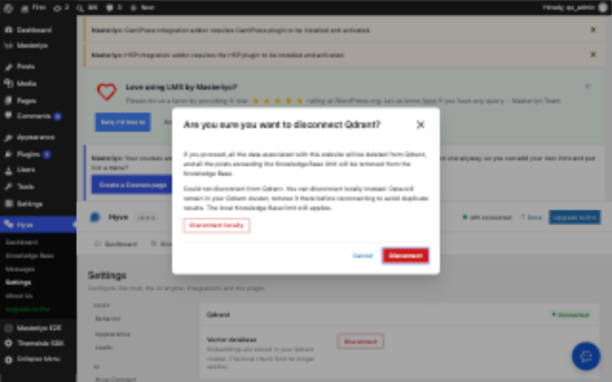

# Qdrant review verification

Verified on 2026-10-24 against the review fixes following `ba12cf2`.

- PHP regression suite: force disconnect skips the remote call, clears credentials, connection/migration/error/retry state and scheduled migration, and restores WordPress storage. Ordinary failed disconnect retains settings and storage.
- Transport regression: the real Qdrant client is wired to a 60-second HTTP timeout and a 10-second connection timeout. At the maximum request duration, a second migration attempt remains blocked by the 600-second lock. A simulated timeout retains local rows and schedules retry.
- Both regression tests fail when their respective production fixes are removed. The timeout assertions run outside the transport callback so application exception handling cannot swallow assertion failures.
- Settings browser suite: 13 tests pass, including an initial failed disconnect and explicit local disconnect. Qdrant responses are intercepted; no external cluster receives data.
- Development browser: built admin bundle on `first.test`, with request-local mocked disconnect responses. Captured POST payloads were `{"force":false}` then `{"force":true}`. The fallback warning rendered, the modal closed, and the store reported disconnected. Reload removed all browser mocks and temporary store changes. No development-site settings were saved.
- The wp-env test plugin was inactive and lacked its standard dummy-key fixture. Reactivated it and restored `bin/set-settings.php` on the isolated test site; the entire Settings suite then passed.

Not proven: a real 60-second stalled network request, an actual multi-process upload overlap, or a remote deployment. The browser uses mocked Qdrant responses; database cleanup is exercised separately through WordPress PHPUnit.
